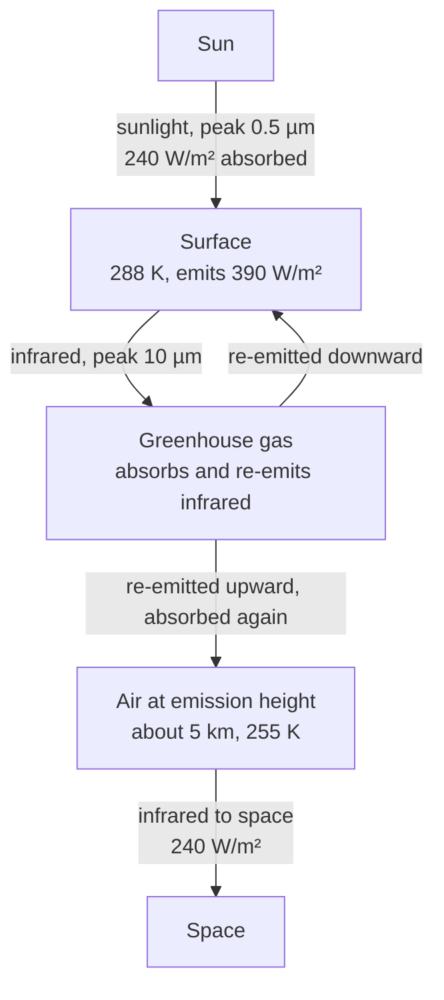
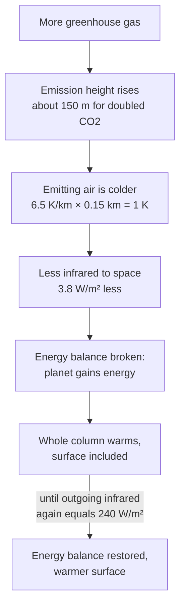

# How do greenhouse gases warm the Earth?

<!-- Stage 2, rendered from model.md. -->

**Answer.** Sunlight passes through the air and warms the surface. The surface sends the energy back out as infrared. Greenhouse gases absorb infrared, so the infrared escapes to space only from high, cold air, about 5 km up. Cold air emits less. To send out enough energy, the planet must be warmer than it would be without the gases. Adding gas lifts the escape point into colder air, so the surface warms more.

## Level 1 — Where the energy goes

The two kinds of radiation have different wavelengths. Sunlight peaks near 0.5 µm, where the air is mostly transparent. The Earth is much colder than the Sun, so its radiation, **infrared**, peaks near 10 µm. A **greenhouse gas** absorbs and emits infrared. <!-- claim: def-greenhouse-gas --> N2 and O2 make up 99% of dry air but do not absorb infrared. A molecule absorbs infrared only if its vibration moves electric charge unevenly; a two-atom molecule of one element cannot do that. CO2, only 0.04% of air, absorbs strongly near 15 µm. Water vapour absorbs across many bands.

**Energy balance** means that the planet emits to space as much as it absorbs. Sunlight brings 1361 W/m²; 30% reflects. The Earth catches sunlight on a disc (area πr²) but emits from a whole sphere (4πr²), so the average absorbed power is 1361 × 0.7 / 4 = 238 W/m², about 240. <!-- claim: why-divide-4 --> If you forget the 4, you get 360 K, which is wrong.

A body emits power σT⁴ per m² (Stefan–Boltzmann law, σ = 5.67 × 10⁻⁸ W m⁻² K⁻⁴). To emit 238 W/m², a body must be at 255 K (−18 °C). The real mean surface is 288 K (15 °C) and emits 390 W/m². Only 240 W/m² reaches space, so the atmosphere holds back 150 W/m². That 33 K difference is the greenhouse effect.

## Level 2 — Why more gas means a warmer surface

**Predict first:** a greenhouse gas absorbs infrared and emits it again. If it emits as much as it absorbs, how can more gas change anything?

<!-- claim: mech-emission-height --> Infrared that leaves near the ground gets absorbed again higher up. Infrared escapes to space only from air with little gas above it. The average altitude of that air is the **emission height**, about 5 km today. The **lapse rate** is how fast air cools with height: about 6.5 K per km. So the emitting air sits at 288 − 6.5 × 5 ≈ 255 K. That is exactly the temperature energy balance requires.

Add gas, and the emission height rises. Doubled CO2 lifts it about 150 m (estimate). The new emitting air is 1 K colder. Because emission goes as T⁴, a 1 K drop at 255 K cuts the output by 4σT³ × 1 K = 3.8 W/m². The planet now gains energy. The whole column warms until the air at the new emission height is back at 255 K. The surface, 5 km of lapse rate below, warms by the same amount: about 1.2 K before feedbacks.

<!-- claim: guar-lapse-rate --> This works only because air gets colder with height. In air of one temperature at every height, a higher emitter would be just as warm. Output would not fall, and more gas would not warm the surface.

## Level 3 — Common mistakes

| Mistake | Correction |
|---|---|
| "Greenhouse gases trap heat like the glass of a greenhouse." | A glass greenhouse works mainly by stopping warm air from rising. Greenhouse gases move the place where the planet emits to space. |
| "CO2 already absorbs all 15 µm infrared, so more CO2 does nothing." | <!-- claim: misc-saturation --> Near the ground, absorption is saturated. The escape point still moves up into colder air, so the effect grows with the logarithm of CO2: each doubling adds about 3.7 W/m². |
| "The gas makes energy." | The source is sunlight. The gas slows energy loss to space. |

Feedbacks multiply the 1.2 K. Warmer air holds more water vapour, a greenhouse gas; melting ice reflects less sunlight. The estimated total for doubled CO2 is likely 2.5–4 K (IPCC AR6). Clouds and ocean heat uptake are outside this explainer.
