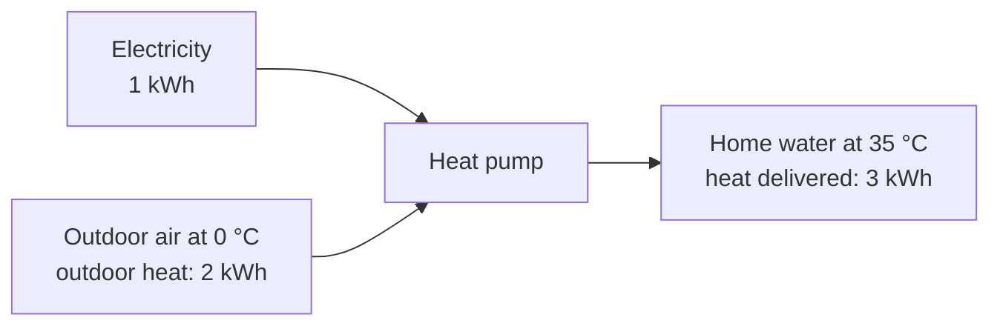
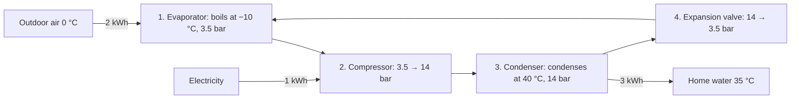

# How can a heat pump give three times more heat than the electricity it uses?

An electric heater turns 1 kWh of electricity into 1 kWh of heat. A heat pump gives about 3 kWh of heat for the same 1 kWh. Where do the other 2 kWh come from?

**Answer:** the heat pump moves heat from the cold outdoor air into the home. The electricity pays for the move. COP = heat delivered ÷ electricity used: heater 1, heat pump 3.

## Level 1

The 2 kWh is outdoor heat. Air at 0 °C still holds heat. Heat flows from the air into the refrigerant because the heat pump makes the refrigerant colder than the air.

## Level 2

Boiling temperature depends on pressure. Propane boils at −10 °C at 3.5 bar and at 40 °C at 14 bar. The compressor raises the pressure so the refrigerant condenses at 40 °C, above the 35 °C water. The valve drops the pressure so it boils at −10 °C, below the 0 °C air. Heat flows hot to cold at both coils.

## Level 3 — What the outdoor temperature does to the COP

The temperature lift is home water minus outdoor air. Colder air is denser and holds more heat per cubic metre, so the heat pump collects heat more easily on a cold day. The COP rises as the outdoor temperature falls.

| Outdoor air | Typical real COP |
|---|---|
| 10 °C | about 2 |
| 0 °C | about 3 |
| −15 °C | about 4 |

The colder the day, the less electricity each kWh of heat needs.
