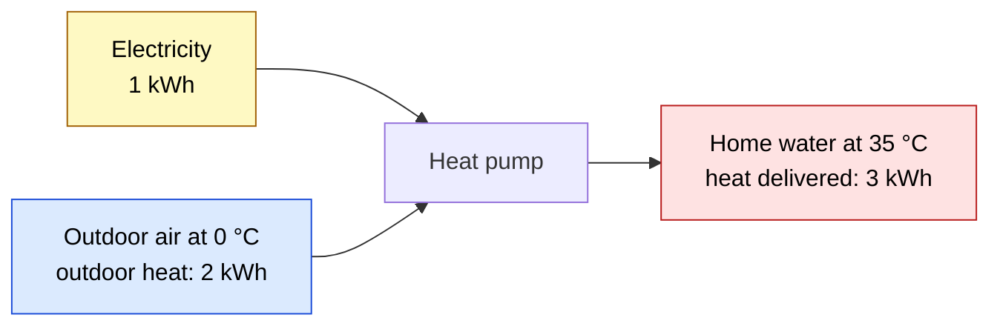
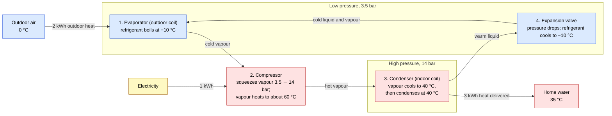

# How can a heat pump give three times more heat than the electricity it uses?

An electric heater turns 1 kWh of electricity into 1 kWh of heat. A heat pump gives about 3 kWh of heat for the same 1 kWh. Energy cannot be created, so where do the other 2 kWh come from?

**Answer:** the heat pump does not make that heat. It moves heat from the cold outdoor air into the home. The electricity pays for the move.

The measure is the **COP** (coefficient of performance): heat delivered ÷ electricity used. An electric heater has COP 1. The heat pump in this example has COP 3.

## Level 1 — Where the 3 kWh comes from

<!-- claim: energy-balance -->

*Colours in both diagrams: blue is the cold side, red is the hot side, yellow is electricity.*

The 2 kWh is **outdoor heat**, taken from the outdoor air. Air at 0 °C is 273 K above absolute zero, so it still holds heat. Heat flows from the air into the heat pump because the heat pump makes the fluid inside it, the refrigerant, colder than the air (Level 2 shows how). The 3 kWh goes into the **home water**: the 35 °C water that flows through the floor pipes or radiators.

An electric heater has only one input, the electricity. So it can give only 1 kWh per kWh.

## Level 2 — How heat moves from cold air into warmer water

<!-- claim: why-compress -->

Suppose you pipe a fluid between the outdoor air and the home, with no other step. The fluid warms to at most 0 °C outside. Inside, the 35 °C water is hotter, so heat flows from the water into the fluid, and the home gets colder.

So the fluid must be colder than the air outside and hotter than the water inside. One fluid can be both, because its boiling temperature depends on its pressure.

<!-- claim: pressure-sets-boiling -->

Propane boils at −10 °C at about 3.5 bar and at 40 °C at about 14 bar. (The air around us is at 1 bar.) At one fixed pressure, propane has one boiling temperature, so it could not be below 0 °C outside and above 35 °C inside. A fluid used this way is a **refrigerant**. It circulates in a closed loop of four parts, at a low pressure on the outdoor side and a high pressure on the indoor side.

<!-- claim: loop -->

Follow the refrigerant once around the loop:

1. **Evaporator** (the outdoor coil). The refrigerant is at 3.5 bar, so it boils at −10 °C. It is colder than the 0 °C air, so 2 kWh of heat flows from the air into it. Boiling takes this heat without a change in temperature.
2. **Compressor.** An electric pump squeezes the vapour from 3.5 bar to 14 bar. It uses 1 kWh of electricity to push on the vapour, and that push heats the vapour to about 60 °C, as a bicycle pump gets warm when you use it.
3. **Condenser** (the indoor coil). The 60 °C vapour cools to 40 °C, then condenses, because at 14 bar propane condenses at 40 °C. The refrigerant is hotter than the 35 °C water, so heat flows into the water. The compressor's 1 kWh is in the vapour too, so the water gets 2 + 1 = 3 kWh.
4. **Expansion valve.** A narrow opening drops the pressure from 14 bar to 3.5 bar. At 3.5 bar the 40 °C liquid is far above its −10 °C boiling point, so about a third of it boils at once. That boiling takes heat from the rest of the liquid and cools all of it to −10 °C. The valve adds no energy and removes none. The refrigerant goes back to step 1.

At both coils, heat flows the normal way, from hot to cold. The compressor raises the pressure and the valve lowers it. Only the compressor uses energy.

## Level 3 — What the outdoor temperature does to the COP

> **Predict first.** The outdoor air drops from 10 °C to −15 °C. The home water stays at 35 °C. Does the COP rise, fall, or stay the same?

<!-- claim: lift-sets-cop -->

The **temperature lift** is the home water temperature minus the outdoor air temperature: 35 − 0 = 35 K in the example. The bigger the lift, the more electricity each kWh of heat needs.

| Outdoor air | Temperature lift | Ideal limit | Typical real COP (estimate) |
|---|---|---|---|
| 10 °C | 25 K | 12.3 | about 4 |
| 0 °C | 35 K | 8.8 | about 3 |
| −15 °C | 50 K | 6.2 | about 2 |
| −25 °C | 60 K | 5.1 | about 1.5 |

The COP falls. At −25 °C the heat pump still beats a heater, but only just; many units add a backup electric heater (COP 1) for the coldest days. Hotter water also raises the lift. Old radiators need 55 °C water: at 0 °C outside, the lift is 55 K and the COP is about 2.2.

### The ideal limit

<!-- claim: ideal-limit -->

Physics sets an **ideal limit** on the COP (physicists call it the Carnot limit). For 35 °C water and 0 °C air it is 308.15 / 35 = 8.8. In symbols:

ideal limit = T_hot / (T_hot − T_cold)

Here T_hot is the home water temperature (308.15 K) and T_cold is the outdoor air temperature (273.15 K). A bigger lift makes the bottom of the fraction bigger, so the limit falls.

<!-- claim: why-kelvin -->

Use kelvin, not Celsius. In Celsius the formula gives 35 / (35 − 0) = 1, which would say that a heat pump can never beat a heater.

### Where the limit comes from

The limit comes from **entropy**. Heat Q that passes at kelvin temperature T carries entropy Q/T, in kWh/K. So 1 kWh carries more entropy at a low temperature than at a high one. Electricity carries no entropy. Nothing can destroy entropy. This is the same law that stops heat flowing from cold to hot by itself. For example, 1 kWh flowing by itself from 308.15 K water to 273.15 K air carries away 1/308.15 and brings 1/273.15, a net gain of 0.00042 kWh/K. The reverse flow would destroy that entropy, so it never happens by itself.

The refrigerant ends each cycle where it started, so it cannot store entropy. The electricity brings none. So the water must get at least as much entropy as the air loses. Write Q_hot for the heat delivered, Q_cold for the outdoor heat, and W for the electricity:

Q_hot / T_hot ≥ Q_cold / T_cold

- **Allowed:** COP 3. The air loses 2 / 273.15 = 0.00732 kWh/K. The water gets 3 / 308.15 = 0.00974 kWh/K. 0.00974 ≥ 0.00732.
- **Forbidden:** a claimed COP 12, with 1 kWh of electricity and 11 kWh from the air. The air loses 11 / 273.15 = 0.0403 kWh/K. The water gets 12 / 308.15 = 0.0389 kWh/K. Entropy would be destroyed, so no machine can do this.

Energy conservation gives Q_cold = Q_hot − W. Put this into the inequality:

1. Q_hot / T_hot ≥ (Q_hot − W) / T_cold
2. Multiply by T_cold: Q_hot × T_cold / T_hot ≥ Q_hot − W
3. Rearrange: W ≥ Q_hot × (T_hot − T_cold) / T_hot
4. Divide: COP = Q_hot / W ≤ T_hot / (T_hot − T_cold)

So the minimum electricity for 3 kWh is 3 × 35 / 308.15 = 0.34 kWh. A real heat pump uses 1 kWh.

### Why a real heat pump gets 3, not 8.8

Heat flows through a coil only across a temperature gap, and a bigger gap moves heat faster through a smaller coil. So the refrigerant boils 10 K below the air (−10 °C) and condenses 5 K above the water (40 °C). Its own lift, the **refrigerant lift**, is 40 − (−10) = 50 K, so the ideal limit for the refrigerant is 313.15 / 50 = 6.3. Losses in the compressor, fans, and pumps take the COP from 6.3 down to about 3.

## Summary

A heat pump does not make 3 kWh of heat from 1 kWh of electricity. It moves 2 kWh of outdoor heat into the home, and the 1 kWh of electricity pays for the move and ends up as heat too. Pressure sets the boiling temperature, so the refrigerant is colder than the air outside and hotter than the water inside. Heat flows the normal way at both coils. The colder the day, the more electricity each kWh of heat needs.

A fridge uses the same loop, with the cold coil inside the fridge.

**Not covered here:** ground-source heat pumps (warmer, steadier cold side, so a higher COP); defrosting the outdoor coil below about 5 °C; money and CO₂ compared with a gas boiler; seasonal COP (the average over a winter); refrigerant choice and safety; why the loop uses a boiling fluid and not a warmed gas.
