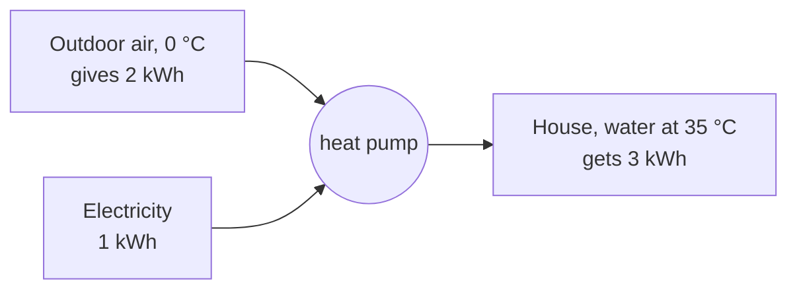
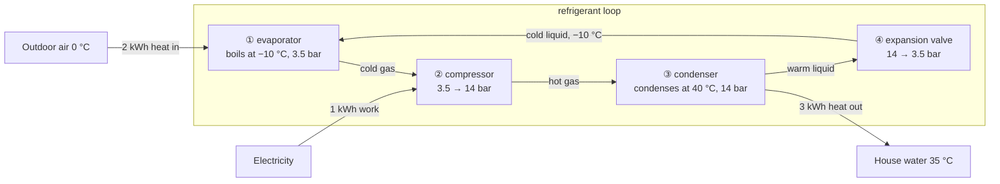

# How can a heat pump deliver three times more heat than the electricity it uses?

<!-- Stage 2, rendered from model.md. Use the model's entity names on every node. -->

**Short answer.** A heat pump does not turn electricity into heat. It uses electricity to *move* heat that already exists in the outdoor air into the house. For each 1 kWh of electricity, it takes about 2 kWh of heat from the air and delivers 3 kWh to the house. No energy is created.

## Level 1 — Where the 3 kWh come from

<!-- claim: balance -->
<!-- claim: move-not-make -->

Energy is conserved: **heat delivered = heat taken from the air + electricity**, so 3 kWh = 2 kWh + 1 kWh.

The ratio of heat delivered to electricity used is the **COP** (coefficient of performance). Here COP = 3 ÷ 1 = 3.

- COP 1 is what an electric resistance heater gets. It turns 1 kWh of electricity into 1 kWh of heat, and conservation of energy forbids more.
- COP 3 is typical for a heat pump on a 0 °C day.
- COP 4 or more is possible on a mild day.

COP is not an efficiency. It counts only the paid input (electricity) and leaves out the free input (heat from the air). That is why it can exceed 1.

Air at 0 °C still holds a lot of thermal energy: 0 °C is 273 K, far above absolute zero. To extract that energy, you only need something colder than the air.

## Level 2 — How the heat is moved: the refrigerant loop

A **refrigerant** is a fluid that circulates in a closed loop and carries the heat. One example is propane (R290). Its boiling point depends on pressure: it boils at about −10 °C at 3.5 bar and condenses at about 40 °C at 14 bar. The heat pump uses this to make the refrigerant colder than the outdoor air at one place and hotter than the house at another.

1. **Evaporator (outdoors).** The refrigerant boils at −10 °C. The air is at 0 °C, so heat flows from the air into the refrigerant: 2 kWh.
2. **Compressor.** <!-- claim: compress --> The electricity (1 kWh) drives the compressor. Squeezing the gas to 14 bar raises its temperature, so it can condense at 40 °C. Without this step, the refrigerant stays at −10 °C. Heat flows only from hot to cold, so −10 °C refrigerant cannot heat 35 °C water.
3. **Condenser (indoors).** The refrigerant condenses at 40 °C. The house water is at 35 °C, so heat flows from the refrigerant into the water. This heat is the 2 kWh from the air plus the 1 kWh of compressor work: 3 kWh.
4. **Expansion valve.** <!-- claim: valve --> The valve drops the pressure to 3.5 bar, which drops the temperature to −10 °C. Without this step, the refrigerant stays at 40 °C. It is then hotter than the 0 °C air, so it gives heat to the outdoors instead of taking it in.

A refrigerator uses the same loop. Its evaporator is inside the box and its condenser is the warm grille at the back.

## Level 3 — Why the COP is about 3 and not higher: temperature lift

<!-- claim: lift-limit -->

The electricity pays to lift heat from a low temperature to a high one. The **temperature lift** is the condenser temperature minus the evaporator temperature. A larger lift needs more work for each kWh of heat moved.

Physics sets a ceiling. No machine can beat the Carnot limit (temperatures in kelvin):

COP_max = T_hot ÷ (T_hot − T_cold)

| Day | Outdoor air | Evaporator | Condenser | Lift | Carnot limit | Real COP (estimate) |
|---|---|---|---|---|---|---|
| Mild | 10 °C | 0 °C (273 K) | 40 °C (313 K) | 40 K | 313 ÷ 40 ≈ 7.8 | about 4 |
| Typical | 0 °C | −10 °C (263 K) | 40 °C (313 K) | 50 K | 313 ÷ 50 ≈ 6.3 | about 3 |
| Cold | −15 °C | −25 °C (248 K) | 40 °C (313 K) | 65 K | 313 ÷ 65 ≈ 4.8 | about 2 |

The real COPs are estimates. A rule of thumb is that real machines reach about half of the Carnot limit, because of friction, imperfect heat exchangers, and other losses.

What the table predicts:

- **Colder outdoor air → lower COP.** The heat pump must lift the heat farther.
- **Cooler indoor water → higher COP.** Large radiators or underfloor heating at 35 °C need less lift than small radiators at 55 °C.
- **COP never falls below 1 in principle.** Even at a large lift, the compressor work itself ends up as heat in the house.

## Summary

The heat pump is a pump for heat. The electricity does not become the heat; it pays for moving heat "uphill" from cold outdoor air to the warmer house. Because moving heat costs less energy than the heat moved, 1 kWh of electricity delivers about 3 kWh of heat. The smaller the temperature lift, the larger that ratio.

**Out of scope:** defrost cycles, ground-source heat pumps, refrigerant choice and safety, and the derivation of the Carnot limit (see entropy and the second law in a thermodynamics text).
